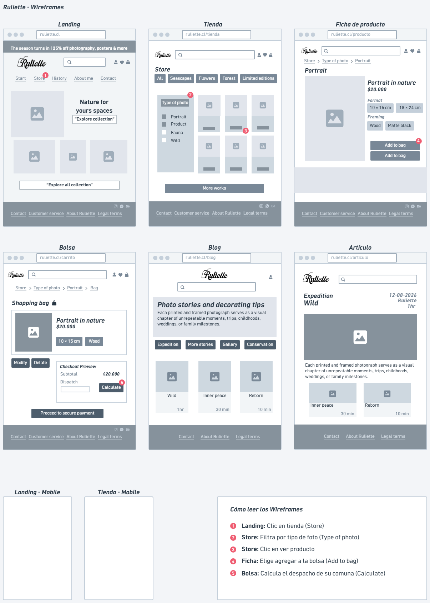

# Spec de diseño — Ruliette

> Guía: [Spec de diseño](../evaluacion/guias/fase-2-specs/06-spec-de-diseno.md)

La spec de diseño tiene dos partes:

1. **[`DESIGN.md`](../DESIGN.md)** (en la raíz): tu design system, en el formato que Stitch importa.
2. **Este documento:** tus pantallas, escritas como prompts listos para pegar en Stitch.

**Wireframes en Whimsical:** [https://whimsical.com/duocuc91/wireframes-ruliette-BZbeQdMSEvMi8ws2XwGxCE]

> Guía: [Spec de diseño](../evaluacion/guias/fase-2-specs/06-spec-de-diseno.md)

**Wireframes en Whimsical:** [Ver tablero de wireframes en Whimsical](https://whimsical.com/duocuc91/wireframes-ruliette-BZbeQdMSEvMi8ws2XwGxCE)

<!-- Captura de los wireframes:  -->

## Pantallas

### 1. Landing

```text
Pantalla: Landing de Ruliette, versión desktop. Usa el design system del proyecto (Verde Bosque #2C3E35, Crema Arena #F9F8F3, tipografía Playfair Display y Plus Jakarta Sans).
Objetivo: Recibir al usuario con una atmósfera serena que comunique en segundos que el sitio ofrece fotografía de naturaleza e impresiones sustentables de alta calidad.

Componentes, de arriba hacia abajo:
1. Navbar: Logo de Ruliette, cintillo superior, menú de navegación (Inicio, Tienda, Historias, Sobre mí, Contacto), buscador con lupa y bolsa de compras.
2. Hero Section: Imagen ambiental en gran formato de un cuadro con paisaje chileno en un living, titular principal "Naturaleza chilena para inspirar tus espacios", bajada descriptiva y botón CTA primario "Explorar Colección" en tono Mostaza (#D99B26).
3. Grid de Categorías / Ambientes ("Shop by Room"): Mosaico de fotografías decorativas organizadas por espacios y temáticas (Paisajes Marinos, Bosque, Fauna Silvestre, Ediciones Limitadas).
4. Botón de Acción Principal (CTA Banner): Bloque destacado que invita a descubrir todo el catálogo de impresiones disponibles.
5. Footer institucional: Logo, enlaces de redes sociales (Instagram, Pinterest), datos de soporte y avisos legales.

### 2. Tienda

Pantalla: Tienda de Ruliette, versión desktop. Usa el design system del proyecto.
Objetivo: Permitir a usuarios vitrinear, filtrar y explorar el catálogo completo de cuadros y láminas de naturaleza de forma fluida según su espacio o región de interés.
Componentes, de arriba hacia abajo:
1. Navbar: Menú de navegación principal y acceso rápido al carrito.
2. Barra de Filtros y Búsqueda: Chips de categorías (Todos, Paisajes Marinos, Bosque y Cordillera, Ediciones Limitadas) y casillas de selección por orientación (Horizontal / Vertical).
3. Grid de Productos (Cards): Cuadrícula con múltiples Tarjetas de Producto que contienen la foto de la obra, etiqueta de ubicación/parque natural, título del cuadro, precio.
4. Paginación / Cargar más: Botón para visualizar más obras del catálogo de autor.
5. Footer institucional: Enlaces a políticas de envío sustentable y contacto.

### 3. Ficha de producto

Pantalla: Ficha de producto de Ruliette, versión desktop. Usa el design system del proyecto.
Objetivo: Entregar al usuario toda la información técnica, estética y narrativa de una obra específica (historia de la toma, dimensiones y tipo de marco) para generarle total confianza en su compra.
Componentes, de arriba hacia abajo:
1. Navbar: Navegación fija del sitio.
2. Visor de Imagen / Previsualizador: Visualizador principal de alta resolución con opción de ver el cuadro en formato individual o simulado en una pared decorada.
3. Panel de Personalización y Compra: Título de la obra, ubicación geográfica del paisaje, selector de tamaño, selector de enmarcado (Madera, Negro mate), precio final y botón principal "Agregar a la Bolsa".
4. Ficha Técnica e Historia de la Expedición: Pestañas o secciones con el relato de la toma fotográfica y detalles del papel de impresión de bajo impacto ambiental.
5. Sección de Obras Relacionadas: Carrusel de cuadros similares por tonalidad o región.
6. Footer institucional.

### 4. Carrito

Pantalla: Carrito de Ruliette, versión desktop. Usa el design system del proyecto.
Objetivo: Mostrar al usuario un resumen transparente y claro de su selección antes de pagar, sin sorpresas en los costos de envío.
Componentes, de arriba hacia abajo:
1. Navbar: Menú simplificado de navegación.
2. Título de Sección: "Tu bolsa de compras (1 producto)".
3. Listado de Ítems en el Carrito: Tarjeta horizontal con miniatura de la obra seleccionada, nombre del cuadro, tamaño, tipo de marco elegido, cantidad y botón para eliminar o modificar.
4. Resumen del Costo (Checkout Preview): Subtotal, calculador de despacho por comuna/región, costo de envío e importe total final claramente destacado en tipografía grande.
5. Botón de Pago: CTA destacado "Proceder al Pago seguro".
6. Footer institucional.

### 5. Blog

Pantalla: Blog de Ruliette, versión desktop. Usa el design system del proyecto.
Objetivo: Acercar al usuario contenido de valor sobre guías de decoración, el detrás de cámara de las expediciones fotográficas y la conservación de la naturaleza chilena.
Componentes, de arriba hacia abajo:
1. Navbar: Menú de navegación principal.
2. Cabecera del Blog: Título principal "Historias de Expedición y Consejos de Decoración" con una bajada introductoria.
3. Filtros de Categorías del Blog: Botones selectoras para navegar entre *Guías de Decoración*, *Historias de Expedición* y *Conservación*.
4. Grid de Artículos (Cards): Rejilla con tarjetas que muestran imagen destacada de la expedición, categoría, título del artículo, extracto breve y tiempo estimado de lectura.
5. Footer institucional.

### 6. Artículo

Pantalla: Artículo del blog de Ruliette, versión desktop. Usa el design system del proyecto.
Objetivo: Sumergir al usuario en la lectura detallada de una guía de decoración o relato de expedición, conectando el contenido directamente con la tienda de cuadros recomendados.
Componentes, de arriba hacia abajo:
1. Navbar: Menú de navegación principal.
2. Cabecera del Artículo: Categoría, título principal en tipografía *Playfair Display*, fecha de publicación, autor (Ruliette) y tiempo de lectura.
3. Imagen Destacada de Cabecera: Fotografía en alta resolución del paisaje o ambiente intervenido.
4. Cuerpo de Texto (Contenido): Párrafos estructurados con subtítulos claros, listas de consejos e imágenes secundarias intercaladas de apoyo.
5. Bloque de Producto Recomendado: Tarjeta destacada al final de la lectura que enlaza directamente al cuadro o lámina mencionada en la historia.
6. Footer institucional.

### Versión mobile (para cada pantalla)

Genera la versión mobile (375px de ancho) de esta pantalla siguiendo la sección Layout del design system: ajustando el menú de navegación a un ícono de menú desplegable (hamburguesa), convirtiendo las cuadrículas de varias columnas en una sola columna vertical con desplazamiento fluido, y asegurando que los botones de llamada a la acción (CTA) tengan un tamaño táctil cómodo y accesible para el dedo pulgar.
