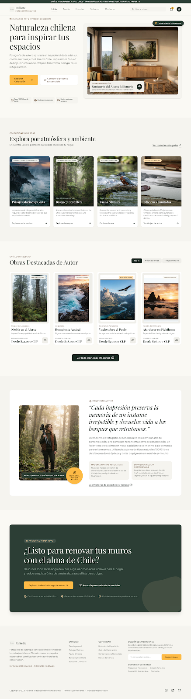
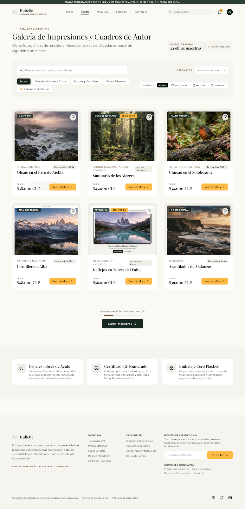
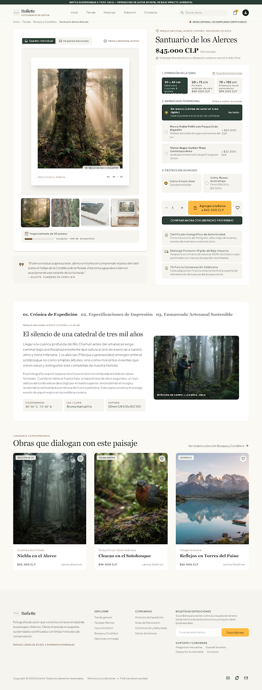
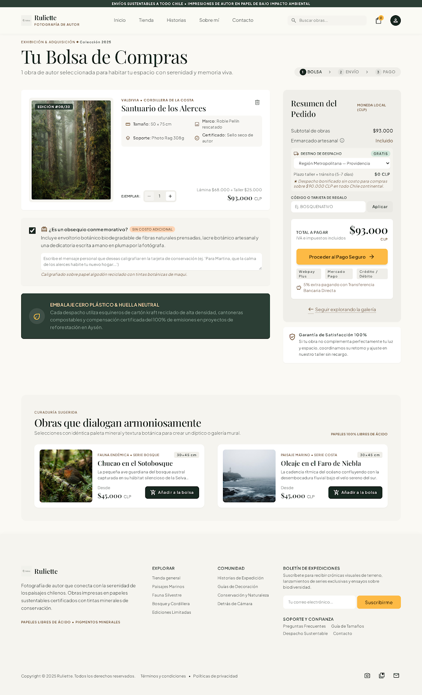
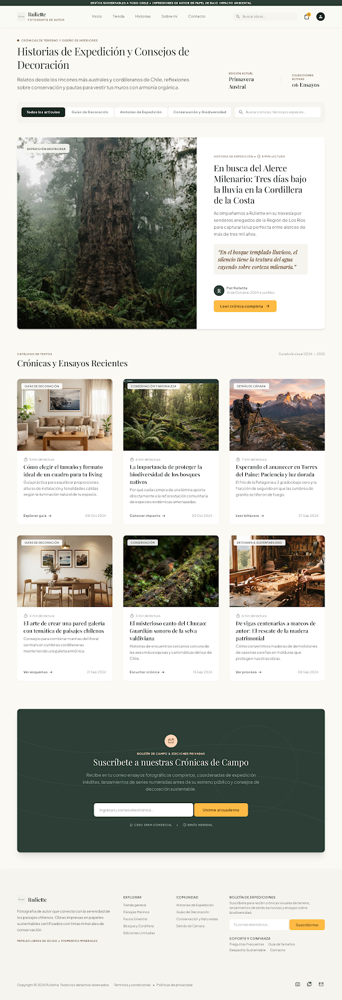
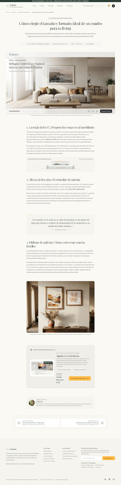

# QA — Ruliette

> Guía: [QA y coherencia](../evaluacion/guias/fase-3-prototipo/02-qa-y-coherencia.md)

## Prototipo en Stitch

> Guía: [Prototipo en Stitch](../evaluacion/guias/fase-3-prototipo/01-prototipo-en-stitch.md)

**Proyecto:** [(https://stitch.google.com/projects/17290348011740893068)]

<!-- Capturas en docs/img/, por ejemplo:  -->

| Pantalla | Desktop | Mobile |
|---|---|---|
| Landing |  | ![Landing Mobile]|
| Tienda |  | ![Tienda Mobile] |
| Ficha de producto |  | ![Ficha Mobile]|
| Bolsa |  | ![Bolsa Mobile]|
| Blog |  | ![Blog Mobile] |
| Artículo |  | ![Artículo Mobile] |

## Revisión: spec vs. prototipo

| Pantalla | Qué dice la spec | Qué generó Stitch | Resultado | Corrección |
|---|---|---|---|---|
| Landing | Botón principal CTA en color Mostaza Silvestre (#D99B26) | Generó el botón en tono Verde Bosque en la primera generación | ❌ → ✅ | Se ajustó la variable `--mostaza-silvestre` en el prompt para forzar el contraste del CTA. |
| Tienda | Rejilla de productos con filtros por categoría y tipo de paisaje | Dispuso los filtros en un menú desplegable oculto | ❌ → ✅ | Se especificó el uso de chips de filtros horizontales visibles directamente sobre el grid. |
| Ficha de producto | Selector de enmarcado con opción en madera nativa y negro | Solo incluyó selector numérico de dimensiones | ❌ → ✅ | Se añadieron radios/botones interactivos para la selección de tipo de marco. |
| Carrito | Desglose claro de subtotal y cálculo de envío según región | Renderizó un resumen simplificado sin espacio de envío | ❌ → ✅ | Se incluyó la sección explícita de estimación de despacho previo al total. |

## Mejoras a mis specs

- **Ajuste de contraste e identidad:** Se reforzó en `DESIGN.md` el uso del color Crema Arena (`#F9F8F3`) como fondo global para evitar fondos blancos genéricos que resta estética editorial.
- **Jerarquía tipográfica:** Se especificó explícitamente el uso de `Playfair Display` con peso *Bold* para los títulos de producto en el catálogo para marcar una presencia de marca más clara.
- **Claridad en componentes mobile:** Se agregaron instrucciones explícitas para colapsar los filtros de la tienda en un panel lateral deslizante en pantallas de 375px.

## User flows

| Flujo | Recorrido en el prototipo | ¿Se completa? |
|---|---|---|
| Compra | Landing (`index.html`) ➔ Clic en "Explorar Colección" ➔ Tienda (`tienda.html`) ➔ Clic en cuadro "Cumbres de Chile" ➔ Ficha de producto (`producto.html`) ➔ Selección de marco y clic en "Agregar a la Bolsa" ➔ Carrito (`carrito.html`). | Sí ✅ |
| Contenido | Landing (`index.html`) ➔ Clic en "Historias de Expedición" en Navbar ➔ Blog (`blog.html`) ➔ Clic en artículo de guía de decoración ➔ Lectura de entrada (`articulo.html`) ➔ Clic en producto recomendado al final de la lectura. | Sí ✅ |

## Coherencia

El prototipo de Ruliette responde fielmente al brief inicial y a las necesidades de nuestra proto-persona Camila, ofreciendo una experiencia serena, elegante y alineada con la apreciación por la naturaleza y el diseño sustentable. A través de la paleta Verde Bosque y Crema Arena, junto con la tipografía editorial Playfair Display, se transmite la propuesta de valor de un arte de autor responsable con el medio ambiente. Desde la Fase 1, el proyecto evolucionó de una idea general de fotografías decorativas a un sistema web estructurado de 6 vistas interconectadas, integrando selectores técnicos de enmarcado, historias de expedición en el blog y un flujo de compra fluido y transparente.